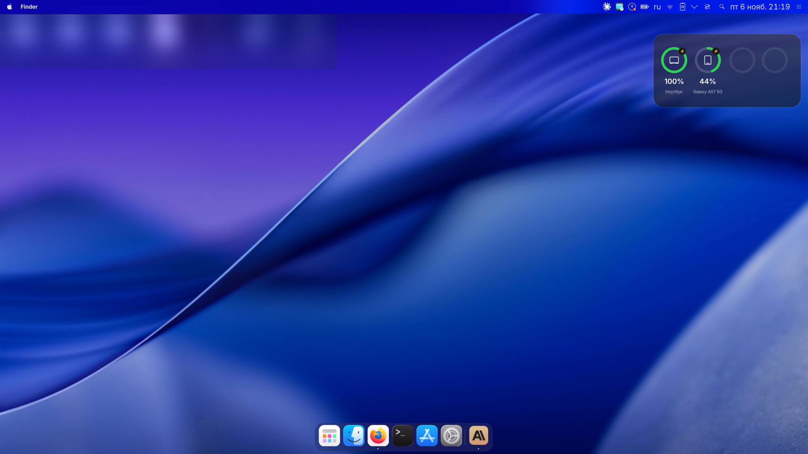
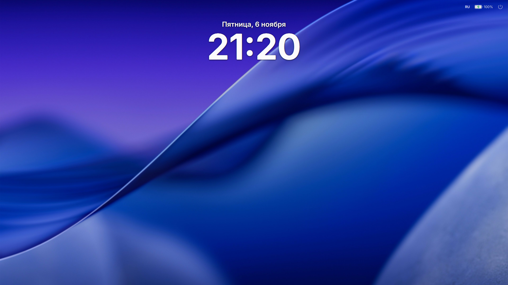
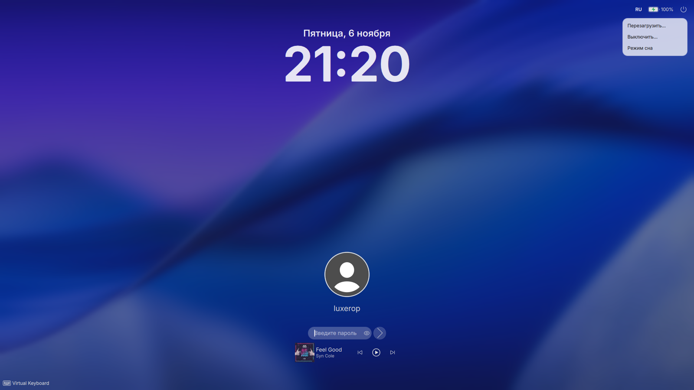
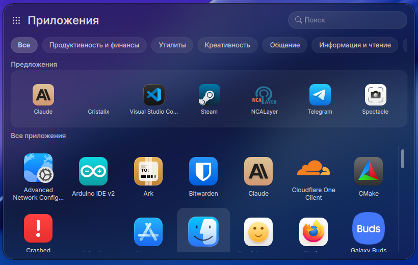
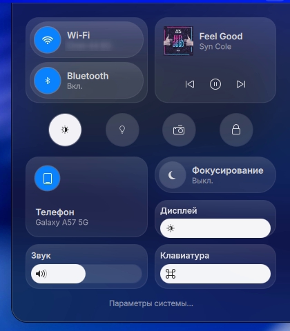
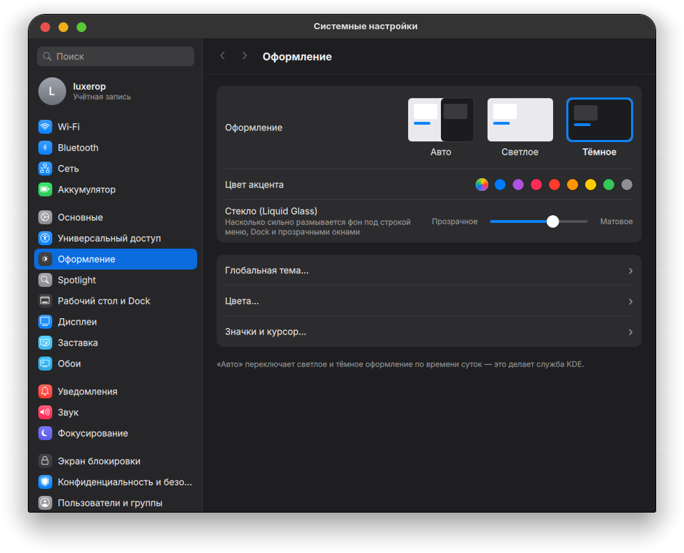
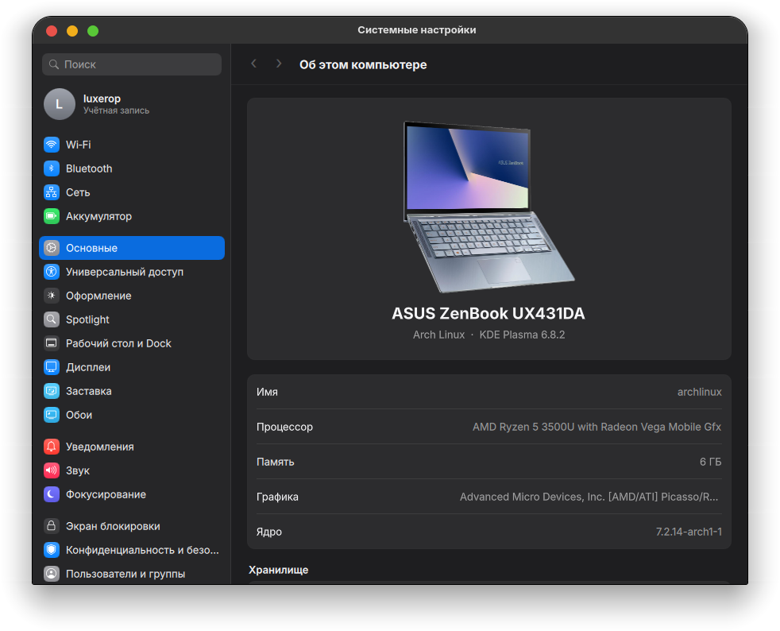
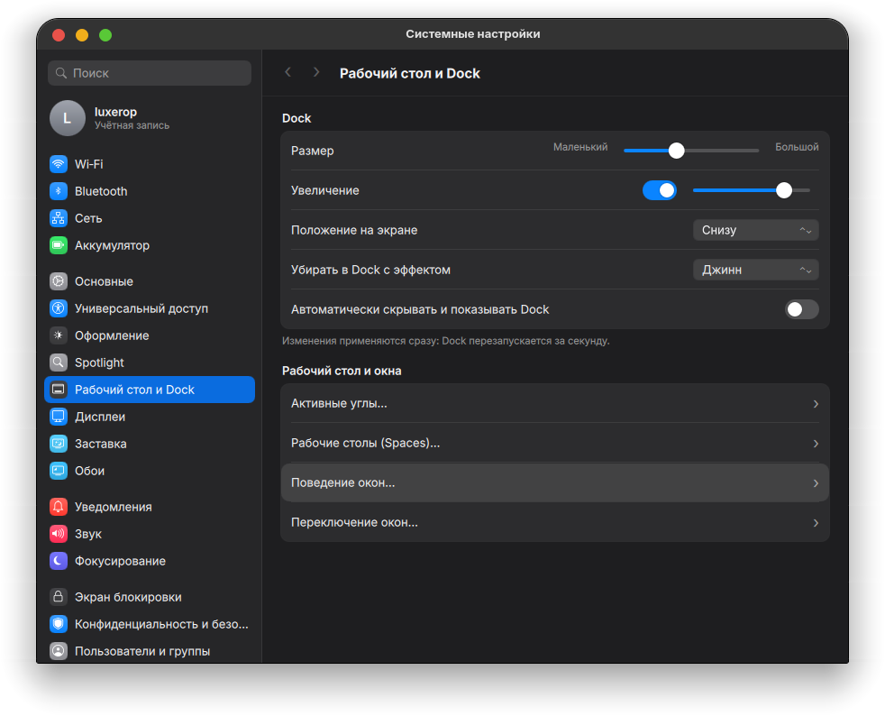
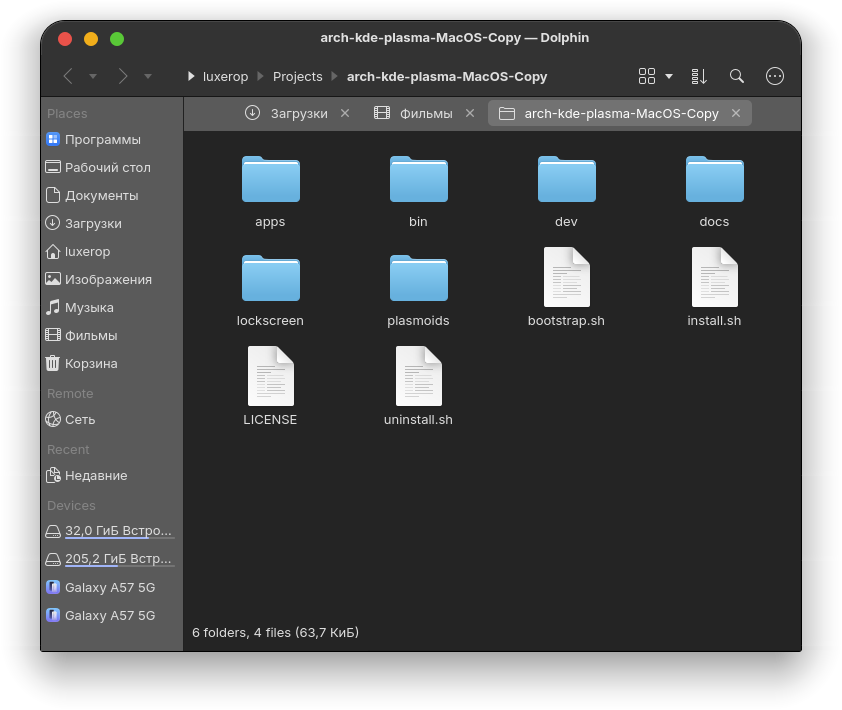
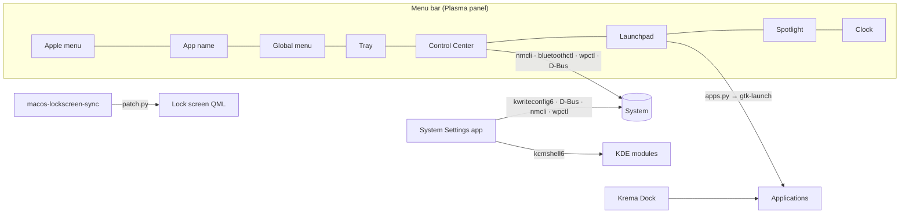

<div align="center">

# macOS for KDE Plasma

**Turn Arch Linux + KDE Plasma 6 into a faithful macOS 27 “Golden Gate” look‑alike — with one command.**

Menu bar, Apple menu, Control Center, magnifying Dock, Launchpad, lock screen, System Settings,
Finder‑style Dolphin and a Batteries widget. Everything is real: every toggle actually changes your system.

[](https://archlinux.org)
[](https://kde.org/plasma-desktop)
[](https://wayland.freedesktop.org)
[](https://www.qt.io)
[](LICENSE)

[](https://github.com/luxeropDev/arch-kde-plasma-MacOS-Copy/stargazers)
[](https://github.com/luxeropDev/arch-kde-plasma-MacOS-Copy/commits/main)
[](https://github.com/luxeropDev/arch-kde-plasma-MacOS-Copy/issues)

**English** · [Русский](README.ru.md)



</div>

---

## Table of contents

- [Highlights](#-highlights)
- [Screenshots](#-screenshots)
- [Quick start](#-quick-start)
- [Installation in detail](#-installation-in-detail)
- [Installer options](#%EF%B8%8F-installer-options)
- [What gets installed](#-what-gets-installed)
- [How it works](#-how-it-works)
- [Keyboard shortcuts](#%EF%B8%8F-keyboard-shortcuts)
- [Uninstall](#-uninstall)
- [Troubleshooting](#-troubleshooting)
- [Project layout](#-project-layout)
- [Credits](#-credits)

---

## ✨ Highlights

| | Feature | What it does |
|---|---|---|
| 🍎 | **Menu bar & Apple menu** | Translucent top bar, Apple menu (About, System Settings, App Store, Sleep, Restart, Shut Down, Lock, Log Out), bold name of the active app, global app menu |
| 🎛️ | **Control Center** | Glass tiles: Wi‑Fi, Bluetooth, Now Playing, Dark Mode, Night Shift, screenshot, lock, Focus (Do Not Disturb), display/sound/keyboard‑backlight sliders |
| 🚀 | **Launchpad (“Apps”)** | macOS 26–27 Apps window: search, category tabs, *Suggestions* row of recently opened apps |
| 🧲 | **Dock with magnification** | [Krema](https://github.com/isac322/krema) — parabolic zoom, glass background, dodge windows, genie minimise effect |
| 🔒 | **Lock screen** | Big clock at the top, avatar and pill password field at the bottom, blinking caret, power menu (Restart / Shut Down / Sleep) in the top‑right |
| ⚙️ | **System Settings** | A macOS 27‑style settings app (PySide6 + QML): edge‑to‑edge sidebar with coloured icons, real controls for Wi‑Fi, Bluetooth, battery, appearance & accent colour, “Liquid Glass” blur, Dock, displays, wallpaper, sound, lock screen, keyboard, mouse & trackpad |
| 🗂️ | **Finder‑style Dolphin** | Finder toolbar (‹ › · path · view · sort · search), Finder sidebar order, 64 px icons, no menubar |
| 🔋 | **Batteries widget** | Desktop widget with rings for the laptop, your phone (via KDE Connect) and Bluetooth devices |
| 📱 | **Samsung Ecosystem Hub** *(optional)* | One window for Galaxy phone, Buds and Watch: KDE Connect, file transfer, scrcpy mirroring, GalaxyBudsClient |
| 🎨 | **Theme** | [MacTahoe](https://github.com/vinceliuice/MacTahoe-kde) KDE/Kvantum/GTK theme, icons and cursors, SF Pro font, traffic‑light buttons on the left |

> [!NOTE]
> This is a **theme and a set of KDE widgets/apps**, not a port of macOS. Nothing from Apple is distributed here.

---

## 📸 Screenshots

<table>
  <tr>
    <td width="50%"><p align="center"><b>Lock screen</b></p></td>
    <td width="50%"><p align="center"><b>Unlock & power menu</b></p></td>
  </tr>
  <tr>
    <td><p align="center"><b>Launchpad / Apps</b></p></td>
    <td align="center"><p align="center"><b>Control Center</b></p></td>
  </tr>
  <tr>
    <td><p align="center"><b>System Settings · Appearance</b></p></td>
    <td><p align="center"><b>System Settings · About</b></p></td>
  </tr>
  <tr>
    <td><p align="center"><b>System Settings · Desktop & Dock</b></p></td>
    <td><p align="center"><b>Finder‑style Dolphin</b></p></td>
  </tr>
</table>

---

## 🚀 Quick start

Requirements: **Arch Linux** (or an Arch‑based distro), **KDE Plasma 6** session, internet, `sudo`.

Open **Konsole** inside your Plasma session and run:

```bash
bash <(curl -fsSL https://raw.githubusercontent.com/luxeropDev/arch-kde-plasma-MacOS-Copy/main/bootstrap.sh)
```

Then **log out and log back in**. That's it.

> [!TIP]
> Want the light look, the Samsung hub and a 1‑second GRUB menu? Pass options to the same command:
> ```bash
> bash <(curl -fsSL https://raw.githubusercontent.com/luxeropDev/arch-kde-plasma-MacOS-Copy/main/bootstrap.sh) --light --samsung --grub-timeout 1
> ```

---

## 📦 Installation in detail

### Option A — one command (recommended)

`bootstrap.sh` clones this repository to `~/.local/share/macos-kde/src` (or updates it) and runs `install.sh`.

### Option B — clone manually

```bash
git clone https://github.com/luxeropDev/arch-kde-plasma-MacOS-Copy.git
cd arch-kde-plasma-MacOS-Copy
./install.sh
```

### What the installer does, step by step

1. **Backs up** your current KDE configuration to `~/.local/share/macos-kde/backup-<date>/` and writes a `restore.sh` there.
2. **Updates the system** and installs packages from the official repos (Kvantum, fonts, PySide6, Dolphin, …).
3. **Builds from AUR** with `yay` (installed automatically if missing): the **Krema** dock and **SF Pro** fonts.
4. **Installs MacTahoe** (KDE, Kvantum, icons, cursors, GTK/libadwaita) from vinceliuice's repositories.
5. **Installs the widgets** (Apple menu, app name, Control Center, Spotlight, Launchpad, Batteries), the **System Settings** app and the **Finder** style for Dolphin.
6. **Patches the lock screen** (see [How it works](#-how-it-works)) and registers services that keep it in sync with Plasma updates.
7. **Applies the look**: global theme, colours, Kvantum, window decorations, fonts, wallpaper, KWin effects (blur, genie), Mac‑like shortcuts.
8. **Builds the layout**: top menu bar + Dock, Batteries widget on the desktop.

You'll be asked for your `sudo` password **once**. The script never restarts Plasma while you are using it — changes apply after you log in again.

> [!IMPORTANT]
> Run the installer **as your normal user**, from inside a **Plasma** session (not from a TTY and not with `sudo`).

---

## ⚙️ Installer options

| Option | Description |
|---|---|
| `--dark` | Dark appearance *(default)* |
| `--light` | Light appearance |
| `--update` | Re‑download MacTahoe themes even if already installed |
| `--samsung` | Also install **Samsung Ecosystem Hub**: `kdeconnect`, `android-tools`, `scrcpy`, GalaxyBudsClient (Flatpak) |
| `--grub-timeout N` | Show the GRUB menu for `N` seconds (backs up `/etc/default/grub`, regenerates `grub.cfg`) |
| `-h`, `--help` | Show help |

---

## 🧩 What gets installed

| Component | Where | Technology |
|---|---|---|
| Apple menu, app name, Control Center, Spotlight, Launchpad, Batteries | `~/.local/share/plasma/plasmoids/org.macos.*` | Plasma 6 plasmoids (QML) |
| System Settings | `~/.local/share/macos-kde/apps/system-settings`, command `mac-system-settings` | Python 3 + PySide6 + QML |
| Finder style | `~/.config/dolphinrc`, `~/.local/share/kxmlgui5/dolphin/dolphinui.rc`, places | config |
| Lock screen | `~/.local/share/plasma/shells/org.kde.plasma.desktop` (patched copy) | QML patch |
| Helpers | `~/.local/bin/macos-*` | Bash |
| Dock | `krema` (AUR) | C++ / Qt 6 |
| Theme | MacTahoe KDE / Kvantum / GTK / icons / cursors | upstream |
| Samsung Ecosystem Hub *(optional)* | `samsung-ecosystem-hub` | Python + PySide6 |

---

## 🔍 How it works



- **No fake buttons.** Widgets and the settings app talk to the real system: NetworkManager (`nmcli`), BlueZ (D‑Bus), PipeWire (`wpctl`), KDE screen brightness and KWin input devices over D‑Bus, KDE config via `kwriteconfig6 --notify`.
- **Apps launch outside Plasma.** Everything opened from the widgets runs in its own `systemd-run --user --scope`, so restarting or crashing `plasmashell` never takes your apps down with it.
- **Lock screen that survives updates.** Since Plasma 6.8 the lock screen lives in the shell package. `macos-lockscreen-sync` copies the system package to `~/.local`, applies a small, strict patch (`lockscreen/patch.py`) and re‑syncs on every login and after every `plasma-desktop` upgrade (pacman hook). If a future Plasma changes the code and the patch no longer fits, it **falls back to the stock lock screen** automatically.
- **Optional auto‑login lock.** If you enable auto‑login, a user service locks the session *before* the desktop appears, so you always land on the macOS‑style lock screen.

---

## ⌨️ Keyboard shortcuts

| Shortcut | Action |
|---|---|
| <kbd>Meta</kbd> + <kbd>Space</kbd> | Spotlight (KRunner) |
| <kbd>Alt</kbd> + <kbd>F1</kbd> | Launchpad |
| <kbd>Meta</kbd> + <kbd>↑</kbd> | Mission Control (Overview) — or move the cursor to the top‑left corner |
| <kbd>Meta</kbd> + <kbd>↓</kbd> | App Exposé |
| <kbd>Meta</kbd> + <kbd>Q</kbd> | Close window |
| <kbd>Meta</kbd> + <kbd>L</kbd> | Lock screen |
| <kbd>Ctrl</kbd> + <kbd>Alt</kbd> + <kbd>Esc</kbd> | Force Quit |
| <kbd>Meta</kbd> + <kbd>Shift</kbd> + <kbd>3</kbd> / <kbd>4</kbd> / <kbd>5</kbd> | Screenshot: full screen / region / Spectacle |

---

## 🧹 Uninstall

```bash
~/.local/share/macos-kde/src/uninstall.sh      # or ./uninstall.sh from your clone
```

Restores your KDE settings from the latest backup, removes the widgets, apps, services and the lock‑screen patch. System packages (Kvantum, Krema, fonts, …) are kept — remove them with `pacman` if you like.

---

## 🛠 Troubleshooting

<details>
<summary><b>The Dock doesn't magnify / there is no Dock</b></summary>

Krema is built from AUR. If the build failed, the installer keeps a regular Plasma dock. Re‑run `yay -S krema`, then log out and in.
</details>

<details>
<summary><b>The desktop flashes before the lock screen after boot</b></summary>

That only happens with auto‑login. Make sure the service is enabled: `systemctl --user enable macos-lock-on-login.service`. Without auto‑login you get the Plasma Login Manager screen, which is a system component and is not themed by this project.
</details>

<details>
<summary><b>The lock screen looks like stock KDE after a Plasma update</b></summary>

The patch is applied automatically on login. To force it: `~/.local/bin/macos-lockscreen-sync --force`. If the patch no longer fits a new Plasma version, the stock lock screen is used on purpose — please open an issue.
</details>

<details>
<summary><b>Show a photo of my laptop in “About this computer”</b></summary>

Put a transparent PNG at `~/.local/share/macos-kde/apps/system-settings/macsettings/ui/images/device.png`. Manufacturer photos are not shipped with this repository.
</details>

<details>
<summary><b>Dolphin did not change</b></summary>

Dolphin must be closed while the Finder style is applied: close it and run `~/.local/share/macos-kde/apps/finder/apply-finder-style.sh`.
</details>

---

## 🗺 Project layout

```
.
├── bootstrap.sh            # one-line installer (clone + install)
├── install.sh              # main installer
├── uninstall.sh            # rollback
├── plasmoids/              # Plasma widgets: applemenu, appname, controlcenter, spotlight, launchpad, batteries
├── lockscreen/             # lock-screen patch, clock, top bar, sync tool
├── apps/
│   ├── system-settings/    # macOS-style System Settings (PySide6 + QML)
│   ├── finder/             # Finder style for Dolphin
│   └── samsung-ecosystem-hub/  # optional Galaxy phone/Buds/Watch hub
├── bin/                    # helpers: appearance switch, launchpad toggle, login lock, GRUB timeout
├── dev/                    # tools for testing widgets without restarting Plasma
└── docs/screenshots/
```

---

## 🙏 Credits

- [vinceliuice](https://github.com/vinceliuice) — MacTahoe KDE, GTK and icon themes
- [isac322/krema](https://github.com/isac322/krema) — Dock with parabolic zoom
- [timschneeb/GalaxyBudsClient](https://github.com/timschneeb/galaxybudsclient) — Galaxy Buds manager
- [KDE](https://kde.org) — Plasma, KWin, KDE Connect, Dolphin

## ⚖️ License & disclaimer

Released under the [GNU GPL v3](LICENSE).
macOS, Apple, Finder, Launchpad and the Apple logo are trademarks of Apple Inc. This project is **not affiliated with or endorsed by Apple**. Samsung and Galaxy are trademarks of Samsung Electronics.

<div align="center">

**If this project made your desktop prettier, please ⭐ star the repo!**

</div>
