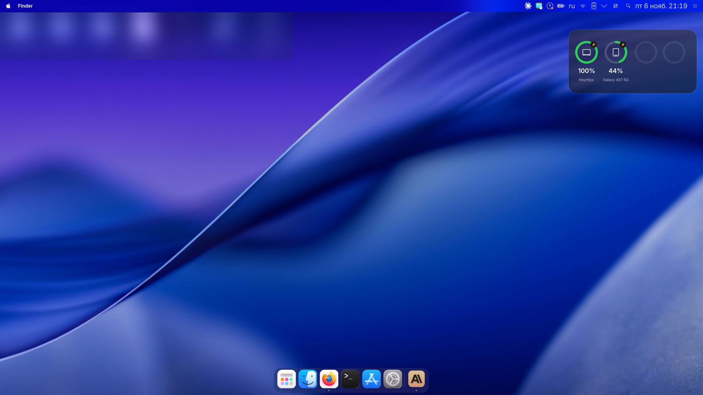
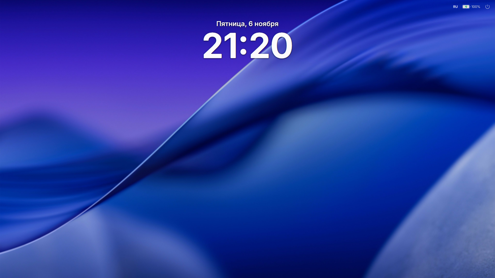
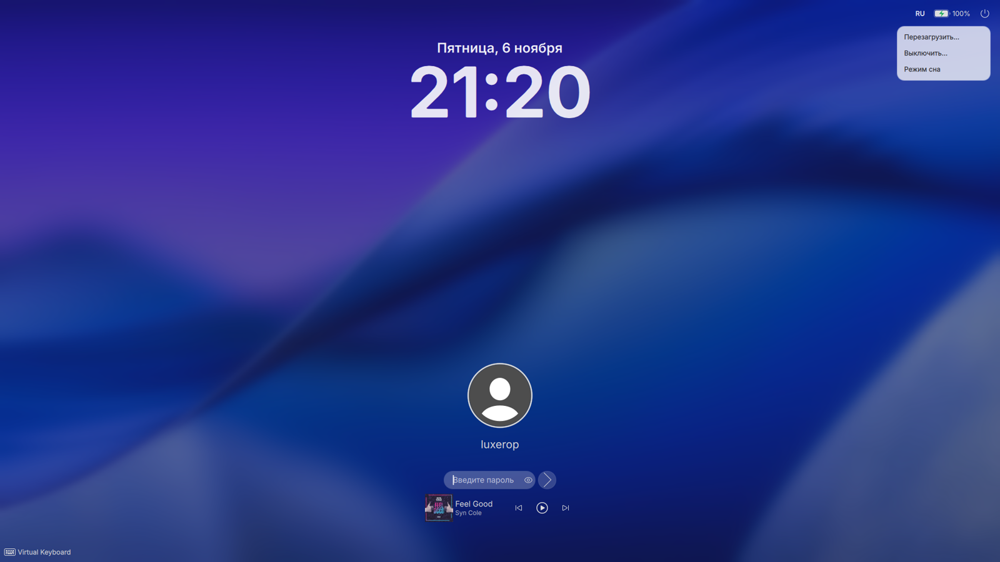
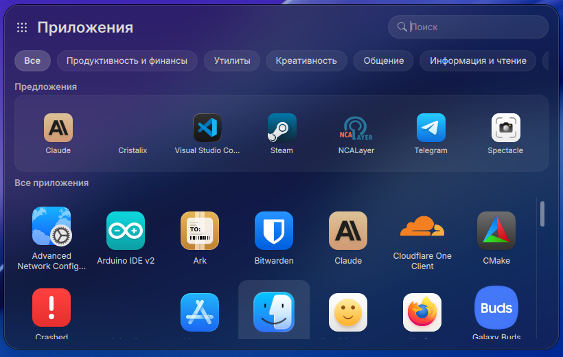
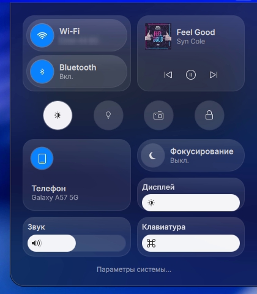
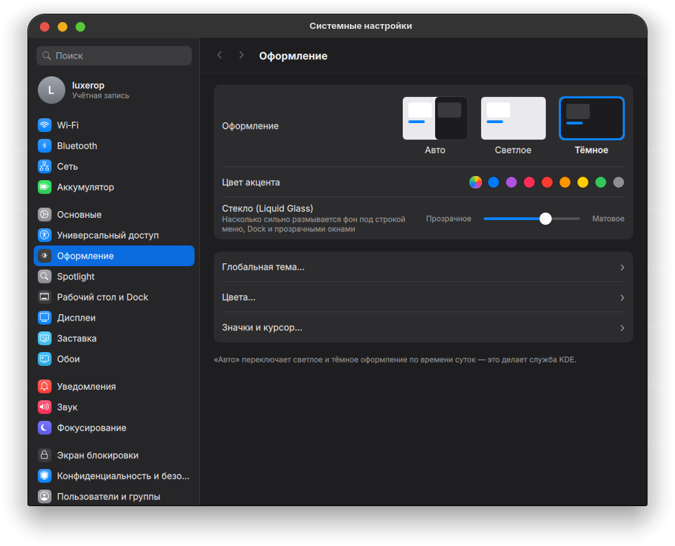
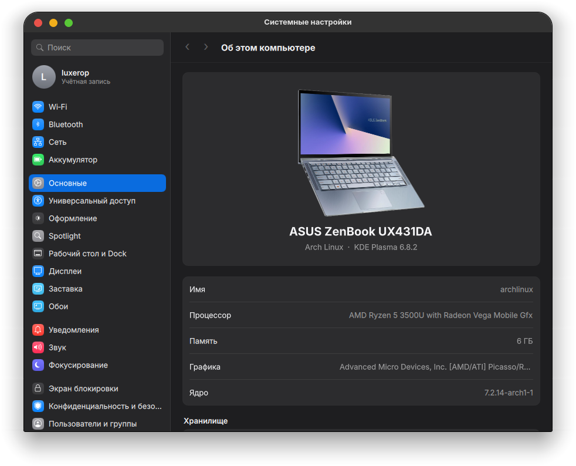
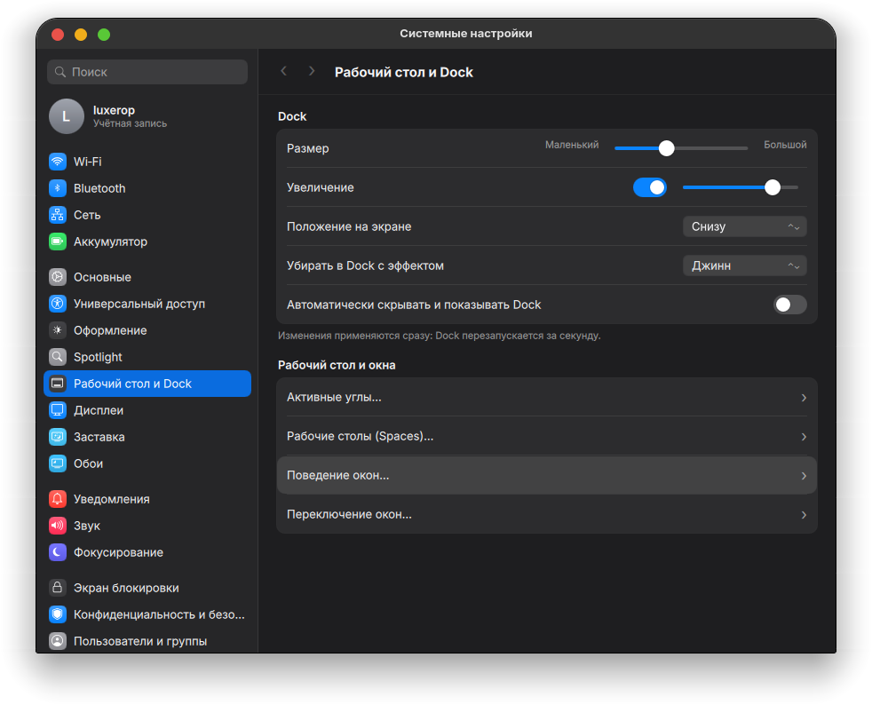
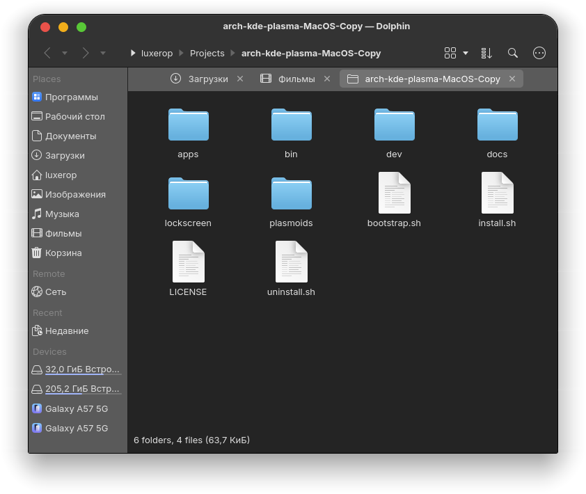
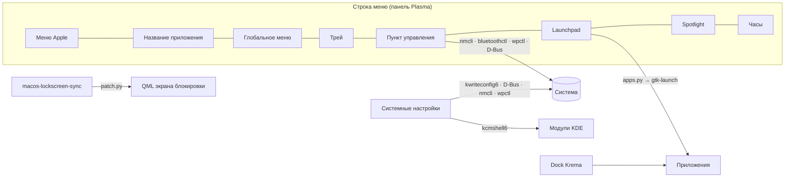

<div align="center">

# macOS для KDE Plasma

**Превращает Arch Linux + KDE Plasma 6 в точную копию macOS 27 «Golden Gate» — одной командой.**

Строка меню, меню Apple, Пункт управления, Dock с увеличением, Launchpad, экран блокировки,
Системные настройки, Dolphin в стиле Finder и виджет «Батареи». Всё настоящее: каждый переключатель реально меняет систему.

[](https://archlinux.org)
[](https://kde.org/plasma-desktop)
[](https://wayland.freedesktop.org)
[](https://www.qt.io)
[](LICENSE)

[](https://github.com/luxeropDev/arch-kde-plasma-MacOS-Copy/stargazers)
[](https://github.com/luxeropDev/arch-kde-plasma-MacOS-Copy/commits/main)
[](https://github.com/luxeropDev/arch-kde-plasma-MacOS-Copy/issues)

[English](README.md) · **Русский**



</div>

---

## Содержание

- [Возможности](#-возможности)
- [Скриншоты](#-скриншоты)
- [Быстрый старт](#-быстрый-старт)
- [Подробная установка](#-подробная-установка)
- [Параметры установщика](#%EF%B8%8F-параметры-установщика)
- [Что устанавливается](#-что-устанавливается)
- [Как это работает](#-как-это-работает)
- [Горячие клавиши](#%EF%B8%8F-горячие-клавиши)
- [Удаление](#-удаление)
- [Решение проблем](#-решение-проблем)
- [Структура проекта](#-структура-проекта)
- [Благодарности](#-благодарности)

---

## ✨ Возможности

| | Что | Как работает |
|---|---|---|
| 🍎 | **Строка меню и меню Apple** | Полупрозрачная верхняя панель, меню Apple (Об этом компьютере, Системные настройки, App Store, Сон, Перезагрузить, Выключить, Заблокировать, Завершить сеанс), жирное название активного приложения, глобальное меню |
| 🎛️ | **Пункт управления** | Стеклянные плитки: Wi‑Fi, Bluetooth, «Сейчас играет», тёмная тема, ночной свет, скриншот, блокировка, «Фокусирование» (Не беспокоить), слайдеры дисплея, звука и подсветки клавиатуры |
| 🚀 | **Launchpad («Приложения»)** | Окно «Приложения» из macOS 26–27: поиск, вкладки категорий, строка «Предложения» с недавно открытыми программами |
| 🧲 | **Dock с увеличением** | [Krema](https://github.com/isac322/krema): параболическое увеличение значков, стеклянный фон, уходит из‑под окон, эффект «джинн» |
| 🔒 | **Экран блокировки** | Крупные часы сверху, аватар и поле пароля‑«пилюля» снизу, мигающий курсор, меню питания (Перезагрузить / Выключить / Сон) справа сверху |
| ⚙️ | **Системные настройки** | Приложение в стиле macOS 27 (PySide6 + QML): боковая панель во всю высоту с цветными значками, настоящие настройки Wi‑Fi, Bluetooth, аккумулятора, оформления и цвета акцента, «стекла» Liquid Glass, Dock, дисплея, обоев, звука, экрана блокировки, клавиатуры, мыши и трекпада |
| 🗂️ | **Dolphin как Finder** | Панель инструментов Finder (‹ › · путь · вид · сортировка · поиск), порядок боковой панели как в Finder, значки 64 px, без строки меню |
| 🔋 | **Виджет «Батареи»** | Кольца заряда ноутбука, телефона (через KDE Connect) и Bluetooth‑устройств на рабочем столе |
| 📱 | **Samsung Ecosystem Hub** *(по желанию)* | Одно окно для Galaxy‑телефона, Buds и Watch: KDE Connect, передача файлов, зеркалирование scrcpy, GalaxyBudsClient |
| 🎨 | **Тема** | [MacTahoe](https://github.com/vinceliuice/MacTahoe-kde) для KDE/Kvantum/GTK, значки и курсоры, шрифт SF Pro, кнопки окна слева |

> [!NOTE]
> Это **тема и набор виджетов/программ для KDE**, а не порт macOS. Ничего от Apple здесь не распространяется.

---

## 📸 Скриншоты

<table>
  <tr>
    <td width="50%"><p align="center"><b>Экран блокировки</b></p></td>
    <td width="50%"><p align="center"><b>Ввод пароля и меню питания</b></p></td>
  </tr>
  <tr>
    <td><p align="center"><b>Launchpad / Приложения</b></p></td>
    <td align="center"><p align="center"><b>Пункт управления</b></p></td>
  </tr>
  <tr>
    <td><p align="center"><b>Системные настройки · Оформление</b></p></td>
    <td><p align="center"><b>Системные настройки · Об этом компьютере</b></p></td>
  </tr>
  <tr>
    <td><p align="center"><b>Системные настройки · Рабочий стол и Dock</b></p></td>
    <td><p align="center"><b>Dolphin в стиле Finder</b></p></td>
  </tr>
</table>

---

## 🚀 Быстрый старт

Нужно: **Arch Linux** (или дистрибутив на его основе), сеанс **KDE Plasma 6**, интернет, `sudo`.

Откройте **Konsole** в сеансе Plasma и выполните:

```bash
bash <(curl -fsSL https://raw.githubusercontent.com/luxeropDev/arch-kde-plasma-MacOS-Copy/main/bootstrap.sh)
```

Затем **выйдите из сеанса и войдите снова**. Готово.

> [!TIP]
> Светлое оформление, Samsung Hub и меню GRUB на 1 секунду — просто добавьте параметры:
> ```bash
> bash <(curl -fsSL https://raw.githubusercontent.com/luxeropDev/arch-kde-plasma-MacOS-Copy/main/bootstrap.sh) --light --samsung --grub-timeout 1
> ```

---

## 📦 Подробная установка

### Вариант А — одной командой (рекомендуется)

`bootstrap.sh` скачивает репозиторий в `~/.local/share/macos-kde/src` (или обновляет его) и запускает `install.sh`.

### Вариант Б — вручную

```bash
git clone https://github.com/luxeropDev/arch-kde-plasma-MacOS-Copy.git
cd arch-kde-plasma-MacOS-Copy
./install.sh
```

### Что делает установщик по шагам

1. **Резервная копия** текущих настроек KDE в `~/.local/share/macos-kde/backup-<дата>/` вместе со скриптом отката `restore.sh`.
2. **Обновляет систему** и ставит пакеты из официальных репозиториев (Kvantum, шрифты, PySide6, Dolphin…).
3. **Собирает из AUR** через `yay` (поставит его сам, если нет): Dock **Krema** и шрифт **SF Pro**.
4. **Ставит MacTahoe** (KDE, Kvantum, значки, курсоры, GTK/libadwaita) из репозиториев vinceliuice.
5. **Ставит виджеты** (меню Apple, название приложения, Пункт управления, Spotlight, Launchpad, «Батареи»), приложение **Системные настройки** и стиль **Finder** для Dolphin.
6. **Патчит экран блокировки** (см. [Как это работает](#-как-это-работает)) и включает службы, которые поддерживают его в актуальном состоянии после обновлений Plasma.
7. **Применяет оформление**: глобальная тема, цвета, Kvantum, рамки окон, шрифты, обои, эффекты KWin (размытие, «джинн»), горячие клавиши как на Mac.
8. **Собирает раскладку**: строка меню сверху + Dock, виджет «Батареи» на рабочем столе.

Пароль `sudo` спросят **один раз**. Скрипт не перезапускает Plasma во время работы — изменения применяются после повторного входа.

> [!IMPORTANT]
> Запускайте установщик **обычным пользователем** из **сеанса Plasma** (не из TTY и не через `sudo`).

---

## ⚙️ Параметры установщика

| Параметр | Что делает |
|---|---|
| `--dark` | Тёмное оформление *(по умолчанию)* |
| `--light` | Светлое оформление |
| `--update` | Заново скачать темы MacTahoe, даже если они уже стоят |
| `--samsung` | Также поставить **Samsung Ecosystem Hub**: `kdeconnect`, `android-tools`, `scrcpy`, GalaxyBudsClient (Flatpak) |
| `--grub-timeout N` | Показывать меню GRUB `N` секунд (делает копию `/etc/default/grub`, пересобирает `grub.cfg`) |
| `-h`, `--help` | Справка |

---

## 🧩 Что устанавливается

| Компонент | Где | Технология |
|---|---|---|
| Меню Apple, название приложения, Пункт управления, Spotlight, Launchpad, «Батареи» | `~/.local/share/plasma/plasmoids/org.macos.*` | Плазмоиды Plasma 6 (QML) |
| Системные настройки | `~/.local/share/macos-kde/apps/system-settings`, команда `mac-system-settings` | Python 3 + PySide6 + QML |
| Стиль Finder | `~/.config/dolphinrc`, `~/.local/share/kxmlgui5/dolphin/dolphinui.rc`, места | конфигурация |
| Экран блокировки | `~/.local/share/plasma/shells/org.kde.plasma.desktop` (копия с патчем) | патч QML |
| Вспомогательные команды | `~/.local/bin/macos-*` | Bash |
| Dock | `krema` (AUR) | C++ / Qt 6 |
| Тема | MacTahoe KDE / Kvantum / GTK / значки / курсоры | upstream |
| Samsung Ecosystem Hub *(по желанию)* | `samsung-ecosystem-hub` | Python + PySide6 |

---

## 🔍 Как это работает



- **Никаких декоративных кнопок.** Виджеты и настройки работают с настоящей системой: NetworkManager (`nmcli`), BlueZ (D‑Bus), PipeWire (`wpctl`), яркость экрана и устройства ввода KWin через D‑Bus, настройки KDE через `kwriteconfig6 --notify`.
- **Программы запускаются отдельно от Plasma.** Всё, что открывается из виджетов, работает в собственной `systemd-run --user --scope` — перезапуск или сбой `plasmashell` не закроет ваши окна.
- **Экран блокировки переживает обновления.** С Plasma 6.8 экран блокировки входит в shell‑пакет. `macos-lockscreen-sync` копирует системный пакет в `~/.local`, накладывает небольшой строгий патч (`lockscreen/patch.py`) и пересинхронизирует его при каждом входе и после каждого обновления `plasma-desktop` (хук pacman). Если новая Plasma изменит код и патч не подойдёт — **автоматически включится стандартный экран блокировки**.
- **Блокировка после автовхода (по желанию).** Если включён автовход, служба пользователя блокирует сеанс *до* появления рабочего стола — после включения вы всегда видите экран блокировки в стиле macOS.

---

## ⌨️ Горячие клавиши

| Сочетание | Действие |
|---|---|
| <kbd>Meta</kbd> + <kbd>Пробел</kbd> | Spotlight (KRunner) |
| <kbd>Alt</kbd> + <kbd>F1</kbd> | Launchpad |
| <kbd>Meta</kbd> + <kbd>↑</kbd> | Mission Control (обзор) — или курсор в левый верхний угол |
| <kbd>Meta</kbd> + <kbd>↓</kbd> | Окна приложения (App Exposé) |
| <kbd>Meta</kbd> + <kbd>Q</kbd> | Закрыть окно |
| <kbd>Meta</kbd> + <kbd>L</kbd> | Заблокировать экран |
| <kbd>Ctrl</kbd> + <kbd>Alt</kbd> + <kbd>Esc</kbd> | Завершить принудительно |
| <kbd>Meta</kbd> + <kbd>Shift</kbd> + <kbd>3</kbd> / <kbd>4</kbd> / <kbd>5</kbd> | Скриншот: весь экран / область / Spectacle |

---

## 🧹 Удаление

```bash
~/.local/share/macos-kde/src/uninstall.sh      # или ./uninstall.sh из вашей копии репозитория
```

Возвращает настройки KDE из последней резервной копии, удаляет виджеты, приложения, службы и патч экрана блокировки. Системные пакеты (Kvantum, Krema, шрифты…) остаются — при желании удалите их через `pacman`.

---

## 🛠 Решение проблем

<details>
<summary><b>Dock не увеличивает значки / Dock отсутствует</b></summary>

Krema собирается из AUR. Если сборка не удалась, установщик оставляет обычный Dock Plasma. Выполните `yay -S krema`, затем перезайдите в сеанс.
</details>

<details>
<summary><b>После включения на секунду мелькает рабочий стол перед экраном блокировки</b></summary>

Так бывает только с автовходом. Проверьте, что служба включена: `systemctl --user enable macos-lock-on-login.service`. Без автовхода показывается экран входа Plasma Login Manager — это системный компонент, его этот проект не оформляет.
</details>

<details>
<summary><b>После обновления Plasma экран блокировки стал стандартным</b></summary>

Патч накладывается автоматически при входе. Принудительно: `~/.local/bin/macos-lockscreen-sync --force`. Если патч не подходит к новой версии Plasma, стандартный экран включается намеренно — откройте issue.
</details>

<details>
<summary><b>Хочу фото своего ноутбука в «Об этом компьютере»</b></summary>

Положите PNG с прозрачным фоном в `~/.local/share/macos-kde/apps/system-settings/macsettings/ui/images/device.png`. Фотографии производителей в репозиторий не входят.
</details>

<details>
<summary><b>Dolphin не изменился</b></summary>

При применении стиля Finder Dolphin должен быть закрыт: закройте его и выполните `~/.local/share/macos-kde/apps/finder/apply-finder-style.sh`.
</details>

---

## 🗺 Структура проекта

```
.
├── bootstrap.sh            # установка одной командой (клонирование + установка)
├── install.sh              # основной установщик
├── uninstall.sh            # откат
├── plasmoids/              # виджеты Plasma: applemenu, appname, controlcenter, spotlight, launchpad, batteries
├── lockscreen/             # патч экрана блокировки, часы, верхняя строка, синхронизация
├── apps/
│   ├── system-settings/    # Системные настройки в стиле macOS (PySide6 + QML)
│   ├── finder/             # стиль Finder для Dolphin
│   └── samsung-ecosystem-hub/  # по желанию: Galaxy телефон / Buds / Watch
├── bin/                    # вспомогательные команды: тема, Launchpad, блокировка, GRUB
├── dev/                    # инструменты для проверки виджетов без перезапуска Plasma
└── docs/screenshots/
```

---

## 🙏 Благодарности

- [vinceliuice](https://github.com/vinceliuice) — темы MacTahoe для KDE, GTK и значки
- [isac322/krema](https://github.com/isac322/krema) — Dock с параболическим увеличением
- [timschneeb/GalaxyBudsClient](https://github.com/timschneeb/galaxybudsclient) — менеджер Galaxy Buds
- [KDE](https://kde.org) — Plasma, KWin, KDE Connect, Dolphin

## ⚖️ Лицензия и оговорка

Распространяется по лицензии [GNU GPL v3](LICENSE).
macOS, Apple, Finder, Launchpad и логотип Apple — товарные знаки Apple Inc. Проект **не связан с Apple и не одобрен ею**. Samsung и Galaxy — товарные знаки Samsung Electronics.

<div align="center">

**Если проект сделал ваш рабочий стол красивее — поставьте ⭐ репозиторию!**

</div>
